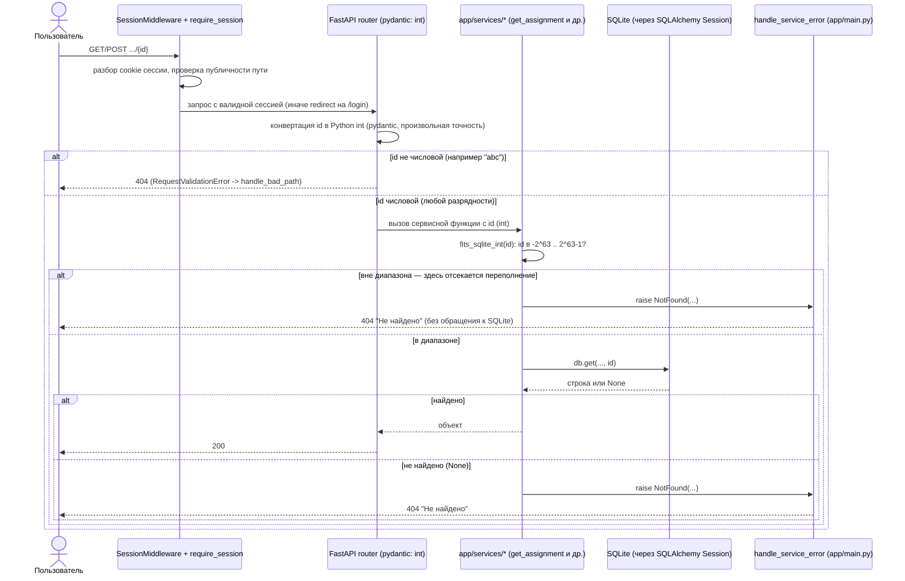

# Design

## Context

См. `proposal.md` — Why. Текущее поведение проверено на `.venv` (TestClient, in-memory SQLite):

- `GET /assignments/{id}`, `POST /assignments/{id}/submissions`, `GET /submissions/{id}`, `POST /submissions/{id}/review` — все четыре маршрута с числовым id в пути падают с `500`, если id вне `-2^63 … 2^63-1`.
- `assignment_id`/`submission_id` объявлены в `app/web/*.py` как `: int` — FastAPI/pydantic конвертирует строку пути в Python `int` без ограничения разрядности (Python-int произвольной точности), поэтому и `9223372036854775808`, и `99999999999999999999` доходят до сервисного слоя как обычный `int`, не как ошибка валидации.
- `OverflowError` возникает не на уровне FastAPI/pydantic, а глубоко внутри `sqlite3`-курсора: `app/services/assignments.py::get_assignment` → `db.get(Assignment, assignment_id)` → SQLAlchemy `Session.get` → `cursor.execute(...)` → `OverflowError: Python int too large to convert to SQLite INTEGER`. Это голый `OverflowError`, не `sqlalchemy.exc.*` и не `RequestValidationError`, поэтому ни один из существующих `@app.exception_handler(...)` в `app/main.py` его не перехватывает — Starlette превращает необработанное исключение в `500`.
- Прецедент есть: `app/services/reviews.py::parse_assignment_filter` уже отсекает значения `> SQLITE_INT_MAX` (`2**63 - 1`) для query-параметра `?assignment_id=`, до обращения к БД, с комментарием «Больше SQLite INTEGER не вместит: db.get упал бы с OverflowError (500)». Для path-параметров той же защиты нет.
- Границы SQLite `INTEGER` подтверждены на `.venv`: `2**63-1` (включительно) и `-(2**63)` (включительно) обрабатываются нормально (обычный поиск, `404` при отсутствии строки); `2**63` и `-(2**63)-1` — уже `OverflowError`/`500`.

## Goals / Non-Goals

**Goals:**
- Для всех четырёх маршрутов с `assignment_id`/`submission_id` в пути исключить `500` для id вне диапазона SQLite `INTEGER`, заменив его на `404` «Не найдено», без обращения к БД.
- Уложить проверку в сервисный слой (`app/services/`), в тех же функциях, что уже делают поиск по id — не трогать `app/web/*.py` и не менять контракт маршрутов.

**Non-Goals:**
- Не меняем поведение для «кривых» нечисловых id (`/assignments/abc`) — оно уже `404` через `handle_bad_path` в `app/main.py` и не трогается.
- Не меняем `docs/baseline.md`, `scripts/check.sh`.
- Не трогаем query-параметр `?assignment_id=` в `/review` — там `SQLITE_INT_MAX`-отсечение уже есть и работает (`review-queue-task-filter`).
- Не вводим новую капу ошибок/коды статусов сверх уже используемого `NotFound` → `404`.

## Decisions

### Где проверять границу: сервисный слой, а не `app/web/*.py`
По архитектуре (`AGENTS.md`) бизнес-правила (в т.ч. валидация) живут только в `app/services/`. Путь-параметры в `app/web/*.py` остаются `: int` — FastAPI/pydantic продолжает конвертировать строку в Python `int` (для нечисловых значений это и сегодня даёт `404` через `RequestValidationError`/`handle_bad_path`, менять не нужно). Проверка «влезает ли id в SQLite INTEGER» добавляется в сервисные функции, которые и так получают уже сконвертированный `int` перед первым `db.get(...)`:

- `app/services/assignments.py::get_assignment` — покрывает `GET /assignments/{id}` и (транзитивно, через `submission_service.create_submission` → `get_assignment`) `POST /assignments/{id}/submissions`.
- `app/services/submissions.py::get_submission_for` — покрывает `GET /submissions/{id}`.
- `app/services/reviews.py::create_review` — сейчас ищет сдачу напрямую через `db.get(Submission, submission_id)`, в обход `get_submission_for`; проверка добавляется здесь же, перед этим `db.get`. Покрывает `POST /submissions/{id}/review`.

Альтернатива — проверять границу в `app/web/*.py` до вызова сервиса — отклонена: это дублирует бизнес-правило в роутере и противоречит разделению слоёв.

### Общая граница вместо отдельной проверки на каждый маршрут
Используем уже существующую константу `SQLITE_INT_MAX = 2**63 - 1` (сейчас объявлена в `app/services/reviews.py`) и добавляем к ней симметричную нижнюю границу `SQLITE_INT_MIN = -(2**63)`. Обе границы — это ровно диапазон, который реально принимает SQLite `INTEGER` (подтверждено на `.venv`), а не производная эвристика.

Константы и проверка выносятся в `app/services/validation.py` (там уже лежит общий `clean_text`, используемый всеми сервисами) как `SQLITE_INT_MIN`, `SQLITE_INT_MAX` и функция вида `fits_sqlite_int(value: int) -> bool`. `app/services/reviews.py::parse_assignment_filter` переключается на импорт оттуда вместо своей локальной константы, чтобы не было двух источников истины. Каждая точка входа (`get_assignment`, `get_submission_for`, `create_review`) сама решает, какое сообщение `NotFound` поднять — в точности как сегодня делает каждая из них для «id нет в базе».

Альтернатива — проверять только верхнюю границу (как в уже существующем `parse_assignment_filter`, который и так работает только с положительными значениями из регэкспа) — отклонена: path-параметр `: int` принимает отрицательные значения (`/assignments/-1` сегодня валиден и корректно даёт `404` как «нет такой задачи»), и сверхотрицательные значения падают с тем же `OverflowError` (проверено на `.venv`). Симметричная проверка — это одно и то же сравнение диапазона, не отдельный механизм, поэтому расширение на нижнюю границу не добавляет сложности.

### Поток обработки запроса

1. Запрос приходит в ASGI-приложение (`app/main.py::create_app`). Порядок middleware: `SessionMiddleware` добавлен последним, поэтому выполняется первым — он разбирает cookie сессии и кладёт `request.session`. После него работает `require_session` (`BaseHTTPMiddleware`): если путь не публичный и в сессии нет пользователя — редирект на `/login`, запрос дальше не идёт.
2. Если сессия есть, Starlette сопоставляет путь маршруту (например, `/submissions/{submission_id}`) и достаёт сырой строковый сегмент пути.
3. FastAPI конвертирует этот сегмент в параметр обработчика по аннотации типа. Для `submission_id: int` это делает pydantic: нечисловая строка (`abc`) здесь проваливается и становится `RequestValidationError`, которую перехватывает `@app.exception_handler(RequestValidationError) -> handle_bad_path` в `app/main.py` и превращает в `404` — это уже работает и не меняется. Числовая строка любой длины и знака успешно становится Python `int` произвольной точности — **переполнение SQLite тут не отсекается**, потому что для pydantic/Python `int` такого ограничения нет.
4. Обработчик роута (`app/web/*.py`) выполняет зависимости (`Depends(current_user)`/`require_mentor`/`require_student`, `Depends(get_db)`) и вызывает сервисную функцию, передавая ей уже сконвертированный `int`.
5. **Здесь и отсекается переполнение**: в начале `get_assignment` / `get_submission_for` / `create_review` (в `app/services/`) новая проверка `fits_sqlite_int(value)` сравнивает `int` с диапазоном `SQLITE_INT_MIN … SQLITE_INT_MAX`. Если значение вне диапазона — сразу поднимается `NotFound(...)`, **до** любого обращения к `Session`/SQLite. Если в диапазоне — выполнение идёт как сегодня, дальше к `db.get(...)`.
6. `NotFound` — подкласс `ServiceError`; он поднимается до `app/web/*.py` без перехвата (роуты не оборачивают вызовы сервиса в `try/except NotFound`) и долетает до `@app.exception_handler(ServiceError) -> handle_service_error` в `app/main.py`, который по таблице `ERROR_STATUS` рендерит `error.html` со статусом `404` и заголовком «Не найдено» — тем же ответом, что и сегодня для обычного отсутствующего id.
7. SQLite (через SQLAlchemy `Session`) вызывается только для значений, прошедших проверку диапазона — туда никогда не попадает `int`, который `cursor.execute` не смог бы забиндить, поэтому `OverflowError` на этом пути больше не возникает.

## Risks / Trade-offs

- **[Risk]** Расширение проверки на отрицательные id меняет поведение чуть шире, чем буквально описано в известной проблеме B (там были только положительные примеры). → **Mitigation**: это то же самое сравнение диапазона (симметричная граница SQLite), не отдельная ветка логики; баланс сложности не меняется, а поведение становится последовательным для всего диапазона `int`. Подтверждено тестами на оба конца диапазона.
- **[Risk]** Перенос `SQLITE_INT_MAX` из `app/services/reviews.py` в `app/services/validation.py` — рефакторинг существующего (пусть и недавно добавленного) кода. → **Mitigation**: `tasks.md` явно требует прогона всего `tests/test_review_queue_task_filter.py` и baseline-тестов после переноса; поведение `parse_assignment_filter` не меняется, меняется только откуда берётся константа.
- **[Risk]** Если какой-то будущий маршрут добавит числовой id в путь и не вызовет `fits_sqlite_int`, уязвимость повторится. → **Mitigation**: вне рамок этого change; явно не покрывается (см. proposal.md — Impact).

## Open Questions

Нет — все решения приняты выше, уточнять у пользователя не требуется для реализации.
