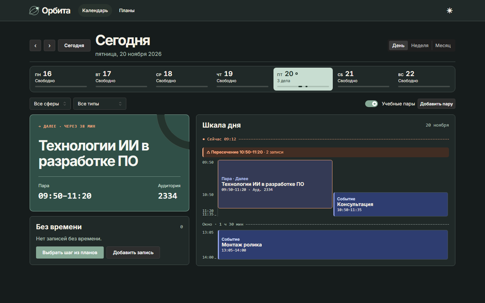

# Орбита

Личный календарь студента. Когда в расписании появляется свободный день, студент может выбрать шаг из своего плана, назначить его на этот день и отметить выполненным. Изменение сразу видно и в календаре, и в прогрессе плана. Учебные пары, дедлайны и личные события помогают выбрать подходящее время.

[Исходный код и клиентские тесты](https://github.com/SaintVenor/Orbit/tree/redesign-flight-plan) · [Условие практики № 8 и шкала на 12 баллов](https://github.com/ai-course-avito/ITMOv2/blob/main/practices/practice_08/README.md)

## Запуск

В PowerShell из корня проекта выполните команды ниже. Проверенное окружение — Windows, Node.js 24 и Python 3.14. Установка включает зависимости React и FastAPI и браузер Chromium для тестов.

```powershell
npm run setup
$env:ORBIT_DB = Join-Path $PWD '.data/practice-08-demo.sqlite3'
npm run seed -- --date 2026-11-20 --flight-plan
npm run dev
```

Откройте [календарь](http://127.0.0.1:5173/calendar). Клиент работает на порту 5173, запросы к `/api` передаются в FastAPI на порту 8000. Демонстрационные данные хранятся в указанном файле SQLite. Для повторного показа с начальным прогрессом укажите новое имя файла. Для обычного использования база по умолчанию — `.data/orbit.sqlite3`, а `npm run seed` добавляет примеры на текущий месяц.

## Что показать на защите

Начните с [субботы, 21 ноября 2026](http://127.0.0.1:5173/calendar?date=2026-11-21&view=month). Этот день свободен в подготовленной демобазе. Снимки ниже сделаны в Chromium через настоящий FastAPI с отдельной SQLite.

| Действие | Что увидит пользователь |
| --- | --- |
| Перейдите в «Планы» и откройте «Снять первый короткий ролик». Вернитесь в «Календарь». | В плане выполнен один шаг из трёх, в материалах есть «Урок по монтажу». Календарь помнит выбранную субботу. [Свободный день](evidence/scenario/free-day.png) |
| Нажмите «Выбрать шаг из планов», затем «Собрать черновик». | В выборе доступны незавершённые шаги без даты. После назначения «Собрать черновик» появляется в повестке. [Выбор шага](evidence/scenario/choose-step.png) |
| Обновите страницу и нажмите «Отметить выполненным». | Шаг сохранился за 21 ноября. После нажатия у него появляется отметка о выполнении. [После перезагрузки](evidence/scenario/assigned-after-reload.png) · [Выполненный шаг](evidence/scenario/completed-step.png) |
| Перейдите по названию плана из повестки. | В плане отмечен тот же шаг, рядом видна назначенная дата. Прогресс изменился с **1 из 3** на **2 из 3**. [Результат в плане](evidence/comparison/plan-app-desktop.png) |

На тех же данных можно показать ещё три случая.

- [20 ноября, вид дня](http://127.0.0.1:5173/calendar?date=2026-11-20&view=day). Включите «Учебные пары». Лекция «Дискретная математика» идёт с 09:00 до 10:30, консультация по проекту начинается в 10:00. Шкала выделяет их общие полчаса. Вид можно переключить на неделю или месяц.
- [28 ноября, вид месяца](http://127.0.0.1:5173/calendar?date=2026-11-28&view=month). «Поездка в Карелию» длится с 27 ноября по 2 декабря. Перейдите стрелкой в декабрь и откройте 1 декабря. Повестка покажет пятый день той же поездки.
- [Галерея планов](http://127.0.0.1:5173/plans). «Пройти маршрут вдоль залива» находится среди выполненных. У плана «Собрать список книг» шагов пока нет, поэтому на карточке доступно действие «Добавить первый шаг».

Для показа собственного расписания доступна команда `npm run import-schedule`. Она добавляет занятия за 16–29 ноября 2026 года. Синим меткам исходного расписания соответствуют лекции, жёлтым — практики, фиолетовым — лабораторные. Остальные занятия сохраняются без типа. Импорт удобно запускать в отдельной базе, чтобы сохранить даты и состав демонстрационного сценария.

## Макет и готовый интерфейс

Два самостоятельных HTML-файла можно открыть в браузере после скачивания репозитория. В [прототипе календаря и планов](design/prototype.html) выберите «Пустой день» и пройдите назначение, выполнение шага и возврат в план. Панель «Состояния макета» также открывает заполненную форму, отправку, успех и ошибку с сохранённым вводом. В [прототипе «Сегодня»](design/today.html) включите пары и поменяйте демо-время, чтобы увидеть смену ближайшего занятия на текущее.

| Экран на одинаковых данных | Макет | Приложение |
| --- | --- | --- |
| План после выполнения «Собрать черновик», прогресс 2 из 3 | [Компьютер](evidence/comparison/plan-prototype-desktop.png) · [Телефон](evidence/comparison/plan-prototype-mobile.png) | [Компьютер](evidence/comparison/plan-app-desktop.png) · [Телефон](evidence/comparison/plan-app-mobile.png) |
| Пятница, 09:12. Следующая пара в 09:50, аудитория 2334 | [1440×900](evidence/comparison/day-prototype-desktop.png) · [390×844](evidence/comparison/day-prototype-mobile.png) | [1440×900](evidence/comparison/day-app-desktop.png) · [390×844](evidence/comparison/day-app-mobile.png) |

В сравнении утреннего экрана время браузера зафиксировано на 09:12, а расписание одинаково задано в прототипе и браузерном тесте. В обычном календаре карточка использует местные часы. В React под заголовком появилась недельная лента для перехода между днями, а предупреждение о пересечении расположено рядом с интервалами на шкале. В тёмной теме у «Что дальше» отдельный фон, у событий есть цвет и текстовая подпись.



## Компоненты и доступность

Клиент написан на React и TypeScript. **Mantine** даёт кнопки, поля, переключатели, карточки, диалоги и состояния загрузки. В календаре используются `Switch` и `SegmentedControl`, в редакторе — `Modal`, `TextInput` и `NativeSelect`. Записи и шаги хранятся в SQLite через FastAPI. [Календарь](frontend/src/features/calendar/CalendarPage.tsx) · [Форма записи](frontend/src/features/calendar/EntryDialog.tsx) · [Карточки планов](frontend/src/features/plans/PlansPage.tsx)

Палитры обеих тем, радиусы и шрифты Inter и PT Serif заданы в теме Mantine. Общие стили задают ширину, отступы страниц и контур фокуса. В сетке месяца Tab переводит фокус на активную дату, стрелки перемещают его, Enter выбирает день. В диалоге поля подписаны, Escape закрывает форму и возвращает фокус на вызвавшую её кнопку. Ширина 360 px проверяется в браузерных тестах. [Тема](frontend/src/app/theme.ts) · [Общие стили](frontend/src/app/styles.css) · [Сетка месяца](frontend/src/features/calendar/MonthGrid.tsx)

## Как использовали AI

Для HTML-прототипов, React-компонентов и тестов использовался Codex. Примеры заданий ниже передают смысл рабочих запросов.

| Этап | Задание для AI | Что изменилось после проверки |
| --- | --- | --- |
| Макет | Сделай кликабельный календарь. Покажи, как назначить шаг из свободного дня и как открыть поездку на границе месяцев. | В первом варианте на телефоне кнопка добавления переносилась, а повестка начиналась слишком низко. Уплотнили сетку и верхнюю панель. При доработке дня сохранили отдельную карточку «Что дальше» и усилили её контраст. |
| Интерфейс | Собери тот же сценарий на готовых компонентах Mantine. Задай общую тему и обеспечь управление с клавиатуры. | После закрытия формы через Escape терялся фокус. Добавили его возврат к кнопке открытия и проверку в браузере. |
| Тесты | Задержи ответ на сохранение, воспроизведи двойной клик и повторный Enter. Проверь ошибку, повторную попытку и видимый результат. | Отдельно проверили случай, когда запись уже сохранилась, но обновить список не удалось. Повтор обновляет список. При временном отключении сообщения об ошибке тест упал на ожидаемом тексте, после восстановления полный набор прошёл. [Вывод контрольного сбоя](evidence/checks/error-hidden.log) |

## Проверки

```powershell
npm run test-client
npm run build
```

Playwright запускает Chromium, локальный API и отдельную временную SQLite. Сквозной тест проходит из календаря в план через настоящий сервер. В тестах состояний `page.route` позволяет задержать запрос, вернуть пустой список или ответ 500 и проверить, что увидит пользователь.

| Пункты оценки | Где проверять |
| --- | --- |
| 1, 5 · AI-макет и соответствие интерфейса | Два кликабельных экспорта и сравнения для телефона и компьютера в разделе «Макет и готовый интерфейс». |
| 2, 3 · Библиотека и единый стиль | Компоненты Mantine, палитры, типографика и общие стили перечислены выше. |
| 4, 11 · Работа с API и полный путь пользователя | Назначить шаг, перезагрузить страницу, выполнить его и увидеть новый прогресс плана. [Сквозной тест](frontend/tests/plans-real.spec.ts) |
| 6, 8 · Доступность и взаимодействие | Проверяются фокус, открытие и закрытие диалога, ввод, выбор даты и результат сохранения. [Браузерные проверки](frontend/tests/calendar-ui.spec.ts) |
| 7 · Защита от повторной отправки | Форма ставит блокировку до ожидания ответа. При двойном клике и двух нажатиях Enter тесты считают один POST, затем одну запись в интерфейсе. [Блокировка](frontend/src/app/useMutation.ts) · [Два теста отправки](frontend/tests/calendar-ui.spec.ts) |
| 9 · Валидация | Пустое название, окончание раньше начала и недопустимая ссылка дают ошибку у поля. Введённые данные сохраняются. [Записи](frontend/tests/calendar-ui.spec.ts) · [Материалы плана](frontend/tests/plans-real.spec.ts) |
| 10 · Загрузка, пустые данные, ошибка и успех | Окно выбора шага показывает загрузку, затем список или пустое состояние. После ошибки назначения шаг можно выбрать снова. [Загрузка](evidence/states/loading.png) · [Пустой выбор](evidence/states/empty.png) · [Ошибка 500](evidence/states/error.png) · [Успешное назначение](evidence/scenario/assigned-after-reload.png) · [Тест с подменой ответов](frontend/tests/plans-picker.spec.ts) |

[Вывод всех клиентских тестов](evidence/checks/client-tests.log) · [Результат сборки](evidence/checks/build.log)

Чтобы переснять материалы, задайте в PowerShell `$env:ORBIT_CAPTURE = '1'` и `$env:ORBIT_CAPTURE_DAY = '1'`, затем запустите `npm run test-client`. Для снимков HTML-макетов после установки задайте `$env:PLAYWRIGHT_BROWSERS_PATH = Join-Path $PWD '.cache/chromium'` и выполните `node scripts/review-prototype.mjs`.
